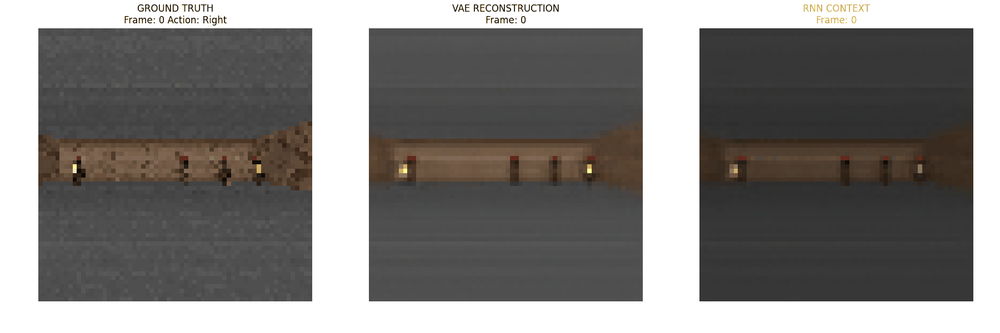
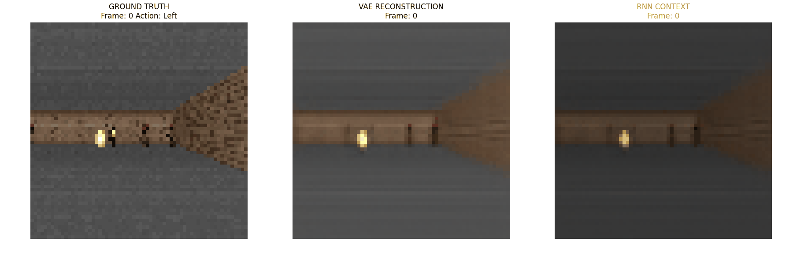
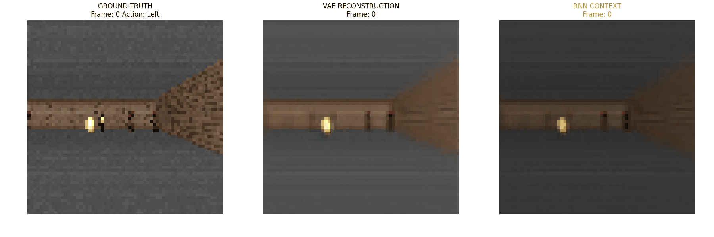

# World Models

A PyTorch implementation of [*World Models* (Ha & Schmidhuber, 2018)](https://arxiv.org/pdf/1803.10122), trained on the Take Cover environment in ViZDoom.

A VAE compresses each frame into a small latent vector. An RNN learns to predict the next latent vector given an action. A small controller is then trained using the RNN's predictions in place of the real game.



From left to right, the clip shows real gameplay, the VAE reconstruction, and the RNN rollout. After the initial context frames, the RNN receives no more real frames. It follows the recorded actions and takes its own predictions as input, so the rollout gradually diverges from the real game.

## Context length

These clips compare giving the RNN one real frame or five before it predicts the rest. A single frame shows where a fireball is, but not which way it is moving.

**1 context frame**



**5 context frames**



## Models

- **VAE.** Encodes each 64 × 64 RGB frame into a latent vector and decodes it back into an image.
- **MDN-RNN.** Takes the latent vector and an action, and predicts a mixture distribution over the next latent vector along with the probability that the episode ends. The rollouts are sampled from this mixture.
- **Controller.** A linear layer that maps the latent vector and the RNN's hidden and cell states to an action. It is trained with CMA-ES inside the rollout and evaluated in the real environment.

## Running the demos

Both demos are run from the repo root.

```
python3 demo/dream.py           # play inside the learned model
python3 demo/grounded_dream.py  # real environment and rollout side by side
```

Trained VAE and RNN checkpoints are required. The weights and rollout datasets are not included in the repo (TODO: add HF link). Set `VAE_PATH`, `RNN_PATH` and the matching model settings near the top of each script.

Use A and D to move, and Q or Esc to quit. In the comparison demo, G resets the rollout to the current real frame. C toggles the controller when a controller checkpoint is loaded. Set `USE_CONTROLLER = False` to start with manual control.

## Code layout

The training order is to collect gameplay, train the VAE, encode the rollouts, train the RNN, and then train the controller in the rollout.

| Path | Contents |
| --- | --- |
| [data/](data) | Random-action rollout collection, datasets and inspection tools |
| [train/](train) | VAE and RNN training, latent preprocessing and CMA-ES controller training |
| [modules/](modules) | The models, the rollout environment and the comparison animation code |
| [notebooks/wm_eval.ipynb](notebooks/wm_eval.ipynb) | Reconstruction and rollout comparisons |
| [notebooks/vae_latent_experiments.ipynb](notebooks/vae_latent_experiments.ipynb) | Experiments with the VAE's latent space |
